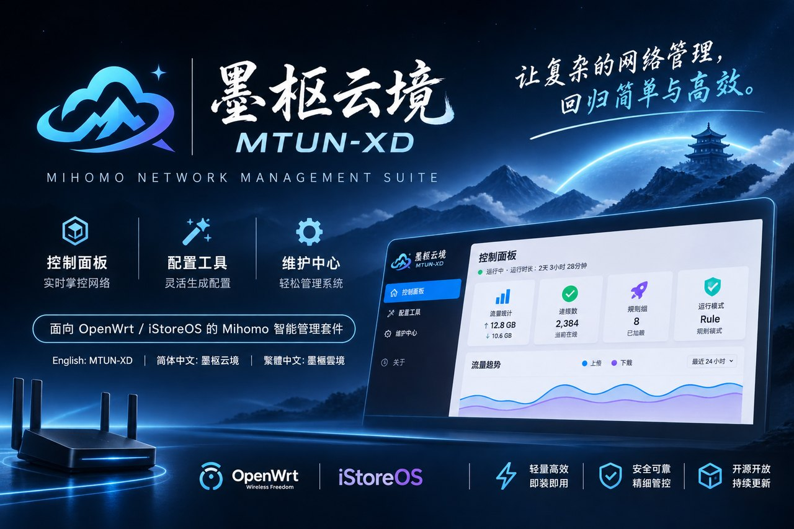
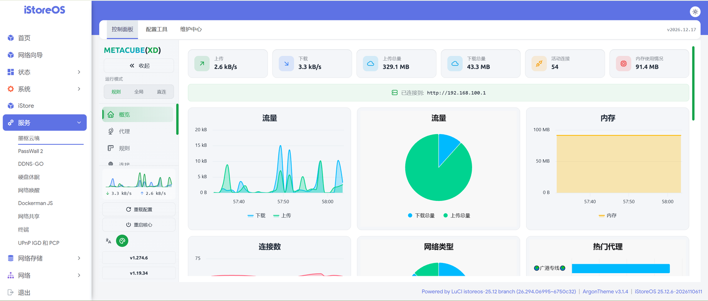

<p align="center"></p>

<h1 align="center">MTUN-XD</h1>

<p align="center">
  A Mihomo management suite for OpenWrt / iStoreOS.<br>
  Focused on stability, reliability, and operational control.
</p>

<p align="center">
  <a href="README.md">简体中文</a> | <strong>English</strong>
</p>

<p align="center">
  <a href="https://github.com/OpenWrt-MTUN-XD/OpenWrt-MTUN-XD/actions/workflows/ci.yml"></a>
</p>

---

## Overview

MTUN-XD bundles the Mihomo core, the MetaCubeXD dashboard, a browser-based config
generator, and maintenance tooling into one LuCI entry: **Services → MTUN-XD**.

## Design principles

MTUN-XD is not built for feature count. It prioritises stability, control, and
predictable behaviour.

- **Auditable config** — deterministic key order and diff-friendly output, easy to review and roll back.
- **Clear boundaries** — does not restart the core or delete files without user approval; control stays with the user.
- **Restrained defaults** — ad blocking is off by default; no unnecessary runtime variables.
- **Reliable deployment** — GEO data is pre-installed, reducing reliance on internet access during the first startup.
- **Verifiable quality** — 176 self-checks and Golden baselines help verify changes.
- **User-controlled node sources** — no subscription hosting or automatic fetching; the node source stays in your hands.

> Predictable behaviour, auditable changes, dependable operation.

### Quality checks

```sh
python tests/test_package.py      # 176 packaging checks (views, scripts, conventions)
bun test generator/tests/unit     # 306 unit tests, including byte-exact Golden baselines
sh tools/check-shell.sh           # shell syntax check
```

CI: [Actions](https://github.com/OpenWrt-MTUN-XD/OpenWrt-MTUN-XD/actions/workflows/ci.yml) ·
Release checklist: [RELEASE-CHECKLIST](docs/RELEASE-CHECKLIST.md)

### Screenshot

<p align="center">
  
</p>

<p align="center"><sub>Dashboard: live traffic, memory and connections; proxy, rule and connection management</sub></p>

### Features

- **Dashboard** — embedded MetaCubeXD, follows the LuCI light/dark theme.
- **Validated apply** — configs are checked with `mihomo -t` before writing; failures roll back and keep a backup.
- **Single entry point** — LuCI, dashboard and config tool all behind port 80.
- **Maintenance centre** — update core, dashboard and suite independently, in the background, with logs.
- **Routing and groups** — precise routing, per-device egress, automatic multi-node load balancing.
- **Config generator** — import nodes (share links / one-shot subscription URLs / Clash YAML / SIP008 / sing-box JSON) and generate a working `config.yaml`; subscriptions are fetched manually, never hosted or auto-updated.

### Requirements

- root access; the installation needs network connectivity
- enough disk space for the Mihomo core for your device architecture
- OpenWrt / iStoreOS with APK or OPKG

### Recommended environment

- **Theme: [Argon](https://github.com/jerrykuku/luci-theme-argon)** — recommended; the UI is adapted to it and supports light/dark modes.
- **System: [iStoreOS](https://fw.koolcenter.com/)** — primary test platform (24.10.8 and 25.12.6 verified). Other OpenWrt-based firmware works as well.

## Install and configure

### Option 1: install on the router (recommended)

SSH into the router as root:

```sh
# GitHub (fallback)
curl -fsSL https://raw.githubusercontent.com/OpenWrt-MTUN-XD/OpenWrt-MTUN-XD/main/install.sh -o /tmp/mtun-xd-install.sh && sh /tmp/mtun-xd-install.sh
```

If GitHub is slow, use the official CF mirror (preferred source for `install.sh`, core, and panel):

```sh
curl -fsSL https://mtun-xd.wxcircle.top/install.sh -o /tmp/mtun-xd-install.sh && sh /tmp/mtun-xd-install.sh
```

After installation, open **LuCI → Services → MTUN-XD**.

### Option 2: build into firmware

Build the suite into an OpenWrt / iStoreOS image. On first boot it fetches the core and
dashboard automatically, using the same `setup` implementation as a standalone install.

See [openwrt/README.md](openwrt/README.md).

### Offline install

The `.apk` / `.ipk` in the Releases page install the suite itself offline (the core and
dashboard are not bundled, ~73 KB):

```sh
# APK-based firmware (OpenWrt 25.12 / iStoreOS 25.12)
apk add --allow-untrusted /tmp/luci-app-mtun-xd-*.apk
# OPKG-based firmware (OpenWrt 24.10 and earlier)
opkg install /tmp/luci-app-mtun-xd_*.ipk
```

The first `mtun-xd setup` still needs network access for the core, dashboard and GEO data.
For a fully offline setup, copy an existing `/etc/mihomo` directory from another working
device and run `mtun-xd setup`; existing core, dashboard, and GEO data are reused; missing ones still
need network access. `config.yaml` is never overwritten.

### Defaults

| Item | Default |
| --- | :---: |
| External UI | `ui` |
| Dashboard password | `123456` |
| External Controller | `127.0.0.1:9090` |

> We recommend changing the default password immediately after your first login.

Open the config tool, import nodes, generate a config, then click **Load config**.

### Security

The controller listens on `127.0.0.1:9090` by default. To expose it, set a `secret` and
restrict access with the firewall. Never expose the controller port to the internet.

## Operations

### Boot delay

After a reboot, the Mihomo core starts with a 40-second delay, waiting for USB storage,
PPPoE and network links to come up.

### Component updates

The buttons in the maintenance centre map to these commands (core → dashboard → suite):

| Button | Command | Scope |
| --- | --- | --- |
| Update core | `/usr/sbin/mtun-xd core` | core binary only |
| Update dashboard | `/usr/sbin/mtun-xd ui` | dashboard static files only |
| Update suite | `/usr/sbin/mtun-xd console` | reinstall the package and run deployment: update the dashboard and config tool when newer versions are available, and install GEO data if missing; **never updates an existing core**, never touches `config.yaml` |

### Uninstall

```sh
mtun-xd uninstall --purge   # remove everything
mtun-xd uninstall           # keep config.yaml, tool password and GEO data
```

## Project

Other channels publishing "unofficial copies" or "custom builds" are not related to this project.
Official releases are published only on GitHub (repository and Releases) and the CF mirror.

The names `MTUN-XD`, `墨枢云境`, `墨樞雲境` and the logo are not authorized for third-party use.
**A code licence does not grant brand rights.**

Install scripts verify checksums; suite packages come only from the channels above, while
the core and dashboard come from their respective upstream releases.

**Links**

[GitHub](https://github.com/OpenWrt-MTUN-XD/OpenWrt-MTUN-XD) ·
[Releases](https://github.com/OpenWrt-MTUN-XD/OpenWrt-MTUN-XD/releases) ·
[Telegram](https://t.me/mtunxd) ·
[Security](https://github.com/OpenWrt-MTUN-XD/OpenWrt-MTUN-XD/blob/main/SECURITY.md) ·
[Contributing](https://github.com/OpenWrt-MTUN-XD/OpenWrt-MTUN-XD/blob/main/CONTRIBUTING.md) ·
[Release checklist](https://github.com/OpenWrt-MTUN-XD/OpenWrt-MTUN-XD/blob/main/docs/RELEASE-CHECKLIST.md) ·
[Architecture](https://github.com/OpenWrt-MTUN-XD/OpenWrt-MTUN-XD/blob/main/docs/ARCHITECTURE.md) ·
[Trademark](https://github.com/OpenWrt-MTUN-XD/OpenWrt-MTUN-XD/blob/main/TRADEMARK.en.md)
