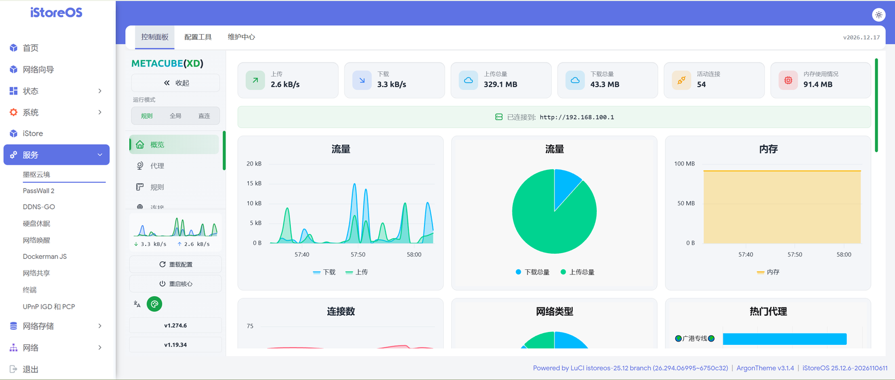

<p align="center"></p>

<h1 align="center">墨枢云境</h1>

<p align="center">
  OpenWrt / iStoreOS 的 Mihomo 管理套件
</p>

---

## 项目介绍

套件把 Mihomo 核心、MetaCubeXD UI、配置生成器、维护功能，收进 LuCI 的「服务 → 墨枢云境」统一入口。

### 界面预览

<p align="center">
  
</p>

<p align="center"><sub>控制面板：流量、内存、连接数实时视图，支持代理 / 规则 / 连接管理</sub></p>

### 功能特性

- **控制面板**：内嵌 MetaCubeXD，跟随 LuCI 明暗主题。
- **一键载入**：写盘前 `mihomo -t` 校验，失败回滚并保留备份。
- **统一入口**：LuCI、面板、配置工具同走 80 端口，无需记端口。
- **维护中心**：核心 / 面板 / 套件分别更新，后台执行，日志可查。
- **分流与分组**：精准分流、按设备 IP 分配出口、多节点自动负载均衡。
- **配置生成器**：导入节点（链接 / 订阅 / Clash YAML），生成可用的 `config.yaml`。

### 系统要求

- root 权限，安装过程需要联网
- 磁盘空间足够放下对应架构的 Mihomo 核心
- OpenWrt / iStoreOS，包管理器为 APK 或 OPKG

### 推荐环境

- **主题：[Argon](https://github.com/jerrykuku/luci-theme-argon)** —— 推荐使用，界面已适配 Argon，支持明暗主题切换。
- **系统：[iStoreOS](https://fw.koolcenter.com/)** —— 主要测试平台，已实测 24.10.8 和 25.12.6。其他 OpenWrt 系固件也可使用。

## 安装与配置

### 安装部署

SSH 登录路由器，以 root 执行：

```sh
# GitHub（主地址）
curl -fsSL https://raw.githubusercontent.com/OpenWrt-MTUN-XD/OpenWrt-MTUN-XD/main/install.sh -o /tmp/mtun-xd-install.sh && sh /tmp/mtun-xd-install.sh
```

国内访问 GitHub 不稳时用 CF 镜像：

```sh
curl -fsSL https://mtun-xd.wxcircle.top/install.sh -o /tmp/mtun-xd-install.sh && sh /tmp/mtun-xd-install.sh
```

安装完成后进入 **LuCI → 服务 → MTUN-XD**（中文界面显示「墨枢云境」）。

固件编译集成见 [openwrt/README.md](openwrt/README.md) —— 编进镜像时只在首次开机拉取核心与面板，与独立安装共用同一套实现。

### 初始配置

安装后会得到一份最小可用配置：

| 配置项 | 默认值 |
| --- | :---: |
| External UI | `ui` |
| 面板密码 | `123456` |
| External Controller | `127.0.0.1:9090` |

首次使用在「配置工具」里导入节点、生成配置，再点「载入配置文件」。

### 安全说明

默认监听（`127.0.0.1:9090`）。如需开放访问，请设置 `secret` 并限制防火墙访问范围，切勿将控制端口暴露到公网。

## 使用与维护

### 开机启动

重启后，Mihomo 核心延迟 40 秒启动。

此延迟用于等待 USB 存储、PPPoE 拨号及网络链路等底层环境完成初始化。

### 组件更新

「维护中心」的按钮等价于下面这些命令，顺序与页面一致（核心 → 面板 → 套件）：

| 维护中心按钮 | SSH 命令 | 实际更新范围 |
| --- | --- | --- |
| 更新核心 | `/usr/sbin/mtun-xd core` | 只更新核心二进制 |
| 更新面板 | `/usr/sbin/mtun-xd ui` | 只换面板静态文件 |
| 更新套件 | `/usr/sbin/mtun-xd console` | 重装套件包并跑部署流程：面板/配置工具有新版就对齐、GEO 缺失补装；**不更新已有核心**、不动 `config.yaml` |

### 卸载

```sh
mtun-xd uninstall --purge   # 全部删除
mtun-xd uninstall           # 保留 config.yaml、工具密码和 GEO
```

## 项目资料

**项目声明**

其他渠道发布的「同款版」「定制版」与本项目无关。

套件正式发布渠道仅限 GitHub 仓库及 Releases，以及 CF 镜像。

`MTUN-XD`、`墨枢云境`、`墨樞雲境` 及 Logo 未授权第三方使用。**代码授权不代表品牌授权。**

安装脚本内置摘要校验，套件安装包仅从上述渠道获取；核心与面板则从各自上游官方渠道获取。

**项目链接**

[GitHub 仓库](https://github.com/OpenWrt-MTUN-XD/OpenWrt-MTUN-XD) · [版本发布](https://github.com/OpenWrt-MTUN-XD/OpenWrt-MTUN-XD/releases) · [Telegram 群组](https://t.me/+Kdxyw8yLTz85ODg5) · [安全报告](https://github.com/OpenWrt-MTUN-XD/OpenWrt-MTUN-XD/blob/main/SECURITY.md) · [参与开发](https://github.com/OpenWrt-MTUN-XD/OpenWrt-MTUN-XD/blob/main/CONTRIBUTING.md) · [发布验收清单](https://github.com/OpenWrt-MTUN-XD/OpenWrt-MTUN-XD/blob/main/docs/RELEASE-CHECKLIST.md) · [项目架构](https://github.com/OpenWrt-MTUN-XD/OpenWrt-MTUN-XD/blob/main/docs/ARCHITECTURE.md) · [品牌与商标声明](https://github.com/OpenWrt-MTUN-XD/OpenWrt-MTUN-XD/blob/main/TRADEMARK.md)
